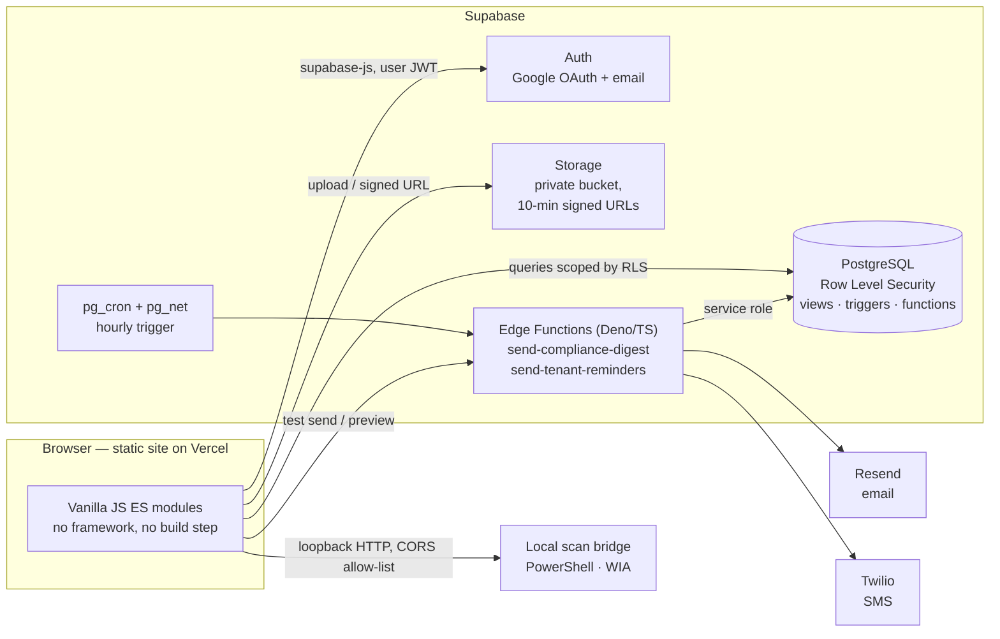
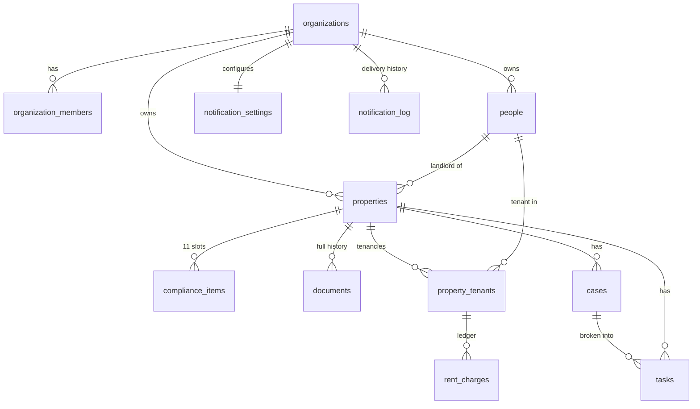

# Atlas — Property Compliance & Management Platform

**A multi-tenant SaaS for UK letting agencies.** Atlas tracks every safety certificate, tenancy and rent payment across a portfolio, and tells the agency, and the tenant, what needs doing before it becomes a legal problem.


**Live:** [swo-co-tracker.vercel.app](https://swo-co-tracker.vercel.app) — in production use by SWO & Co, a London letting agency (sign-in required).

---

## The problem

A UK landlord must hold a valid Gas Safety Certificate (renewed every year), an Electrical Installation Condition Report (every five years) and an EPC for every let property. They must also protect a tenant's deposit within 30 days of receiving it and serve a defined set of documents at the start of a tenancy. Missing any one of these can mean a fine, an invalid eviction notice, or a tenant left in an unsafe home.

SWO & Co ran all of this from a spreadsheet and a Google Apps Script that emailed a daily list of expiring dates. It worked until the business needed more than dates: where the certificate itself was, which tenant lived where, whether rent had arrived, which repairs were open. A second agency could not use it at all.

**Atlas replaces the spreadsheet with a relational system of record and a rules engine for "what is due", built so that any number of agencies can share one deployment without ever seeing each other's data.**

## What it does

| Area | Capability |
|---|---|
| **Today's Desk** | One prioritised list of everything coming due: certificates, tenancy ends, break clauses, rent reviews, unprotected deposits and overdue rent. Urgency is colour-banded and every item links to its property. |
| **Property passport** | The complete record of a property on one page: 11 compliance document slots, landlord, tenancies, rent ledger, open cases and tasks, and the full history of every document and job. |
| **Document storage** | Upload or scan a certificate (on a phone the camera captures several pages into one PDF). Superseded files are kept, never overwritten, so ten years of gas certificates stay retrievable for an audit. |
| **Portfolio monitor** | A property × certificate grid sorted worst-first, so the board opens on whatever needs attention. |
| **Tenancies & rent ledger** | Full contract terms (rent, deposit and scheme, notice period, break clause, review date), a generated schedule of rent charges, payment recording, part payments, waivers and arrears. |
| **People, cases, tasks** | Landlords, tenants and contractors (filterable by trade), plus repair and dispute cases broken down into dated tasks. |
| **Automated reminders** | A configurable compliance digest by email to the agency, an SMS to the manager when something is urgent, and rent reminders and arrears chasers to tenants by email and SMS. |
| **Multi-tenant workspaces** | Each agency signs itself up and gets an isolated workspace. Google or email sign-in, owner/member roles. |

## Architecture



**The database does the real work.** The browser is a thin client: authorisation is enforced by Postgres Row Level Security rather than by application code, and the definition of "what is due" lives in SQL views that the dashboard and the email both read.

## Engineering highlights

These are the design decisions I'd point to in a code review.

**Tenant isolation enforced by the database, not by the client.**
Every business table carries an `organization_id`. A `security definer` helper, `is_org_member()`, backs 27 RLS policies that default-deny across workspaces. For child tables a trigger *derives* `organization_id` from the parent row, so the client is never trusted to supply it. The publishable API key ships to the browser on purpose: RLS is the boundary, not key secrecy.

**One definition of "due", by construction.**
An `upcoming_events` view unions every dated obligation: certificate expiries, tenancy ends, rent reviews, break clauses, the 30-day deposit-protection deadline and unpaid rent. `upcoming_alerts` filters and bands that list using each workspace's own settings. The dashboard and the digest email read the same view, so they cannot disagree. Both views are `security_invoker`, so they respect the querying user's RLS.

**An idempotent rent ledger that doesn't invent history.**
`generate_rent_charges()` builds charge rows from tenancy terms and relies on a unique constraint on `(tenancy, due_date)`, so the daily job can re-run safely. It deliberately generates from the current period forward: backfilling a tenancy from 2019 would manufacture arrears that were paid years before the system existed. Fixed-term and periodic (rolling) tenancies have different end-date semantics, which a dedicated migration corrects.

**At-most-once delivery to consumers.**
A tenant must never receive the same "your rent is late" message twice. Every send first *claims* a `dedupe_key` in `notification_log`, enforced by a partial unique index. A retried or concurrent run loses the insert race and stops. A failed send releases its claim but keeps the row, so the failure stays visible and the message can be retried. Manual runs default to a dry run, and tenant messaging is off until a workspace enables it.

**Per-workspace scheduling across timezones.**
Rather than one global cron time, the job fires hourly and each workspace is processed at *its own* send hour in *its own* IANA timezone. Guards prevent a double send when clocks go back or a run is retried.

**Defensive handling of untrusted input in outbound mail.**
Each workspace can set its own sender identity. The value is constrained in the database column *and* re-sanitised in the Edge Function, because it becomes an SMTP header, where a stray newline would allow header injection. An unverified domain falls back to the platform sender so SPF/DKIM never fail.

**Migrations that never destroy data.**
Twenty-plus versioned SQL migrations evolve the schema in place. Spreadsheet refreshes match properties by address, update in place, and *raise* on an unmatched row rather than skipping it. A silent no-match on free-text addresses is exactly the failure that would leave a portfolio half-updated. Each data correction ships with an undo script.

**Hardware access the browser can't provide.**
No browser exposes TWAIN/WIA to JavaScript, so desktop scanning goes through a small dependency-free PowerShell bridge. It binds to loopback only and answers CORS solely for allow-listed origins, so no other website can read what's on the scanner glass.

## Tech stack

| Layer | Technology |
|---|---|
| Frontend | HTML, CSS custom properties, vanilla JavaScript (ES modules), `<dialog>` modals, PWA manifest |
| Backend | Supabase: PostgreSQL, Row Level Security, PL/pgSQL functions and triggers, `security_invoker` views |
| Auth | Supabase Auth: Google OAuth 2.0, email/password, password reset |
| Files | Supabase Storage: private bucket, short-lived signed URLs |
| Serverless | Supabase Edge Functions: Deno + TypeScript |
| Scheduling | `pg_cron` + `pg_net` |
| Messaging | Resend (email), Twilio (SMS, E.164 normalisation) |
| Hosting / CI | Vercel (production + preview per branch), GitHub Actions → GitHub Pages |
| Tooling | PowerShell 5.1 scan bridge (Windows Image Acquisition) |

## Data model



## Project structure (private repository)

```
├── index.html, style.css      App shell, design tokens
├── app.js, auth.js            Boot, routing, sign-in, workspace onboarding
├── workspace.js               Active organisation and role
├── dashboard.js, monitor.js   Today's Desk and the portfolio grid
├── properties.js              Property list and passport
├── documents.js, scan.js      Storage, signed URLs, camera and scanner capture
├── tenancies.js, rent.js      Contract terms and the rent ledger
├── people.js, cases.js, tasks.js
├── reminders.js               Notification settings and delivery history
├── sql/                       Schema, RLS, and 20+ versioned migrations
├── supabase/functions/        Edge Functions (Deno/TypeScript) + shared SMS module
├── tools/                     Windows scan bridge
└── docs/SETUP.md              Setup and operations guide
```

Around 4,600 lines of front-end code, 2,800 lines of SQL and 1,000 lines of TypeScript.

## Source code

**Atlas's source is kept in a private repository**, because it runs a live client's portfolio and its migrations carry real property data. I'm happy to walk through the code or grant read access for an interview. Contact me through [GitHub](https://github.com/SanorSmith).

**This repository holds v1**, the original Google Apps Script tracker that Atlas replaced:

| File | What it is |
|---|---|
| `Code.gs` | Apps Script bound to the agency's Google Sheet: reads certificate dates, buckets them by urgency, sends the daily HTML email digest, and serves a small web app for editing property rows |
| `index.html` | The v1 web app / PWA front end |
| `manifest.json`, `OneSignalSDKWorker.js` | PWA install manifest and push-notification worker |

Comparing the two shows the step from a sheet-plus-script to a relational, multi-tenant system: v1's fixed column indices and single hard-coded recipient became Atlas's normalised schema, per-workspace settings and row-level security.

## Security

- **Authorisation:** Postgres RLS on every table, default-deny, scoped to workspace membership. Owner-only updates on notification settings.
- **Elevated paths:** `security definer` functions carry their own membership checks. The service role key is used only server-side by Edge Functions.
- **Edge Functions:** they verify the caller's JWT and confirm the caller belongs to the workspace before acting on it. Only the scheduled service-role run may touch every workspace.
- **Files:** the bucket is private, and documents are served through signed URLs that expire after 10 minutes.
- **Output encoding:** all user content is HTML-escaped on render. Mail headers are sanitised against injection.

## Project history

| Stage | What changed |
|---|---|
| v1 | Google Sheet + Apps Script: daily email of expiring certificates |
| Foundation | Supabase schema, Google sign-in, dashboard, properties |
| Documents | Property passport, 11 compliance slots, storage with full history, scanning |
| Operations | People, cases, tasks, tenancy contracts, activity history |
| Multi-tenancy | Workspaces, organisation-scoped RLS, self-service onboarding |
| Reminders | Per-workspace digest settings, timezone-aware scheduling, delivery log |
| Rent | Rent ledger, payments and arrears, tenant reminders by email/SMS, manager SMS |
| Production | Real portfolio migrated from the spreadsheet; replaced v1 in October 2026 |

**Next:** inviting staff into an existing workspace, assigning cases and tasks to staff, and a tenant-facing portal.

## Author

**Sanor Smith** — designed and built end to end: requirements with the agency, data model, security model, front end, serverless functions and deployment.

[GitHub](https://github.com/SanorSmith)

---

<sub>© 2026 Sanor Smith. Source shared for portfolio and reference purposes. All rights reserved.</sub>
